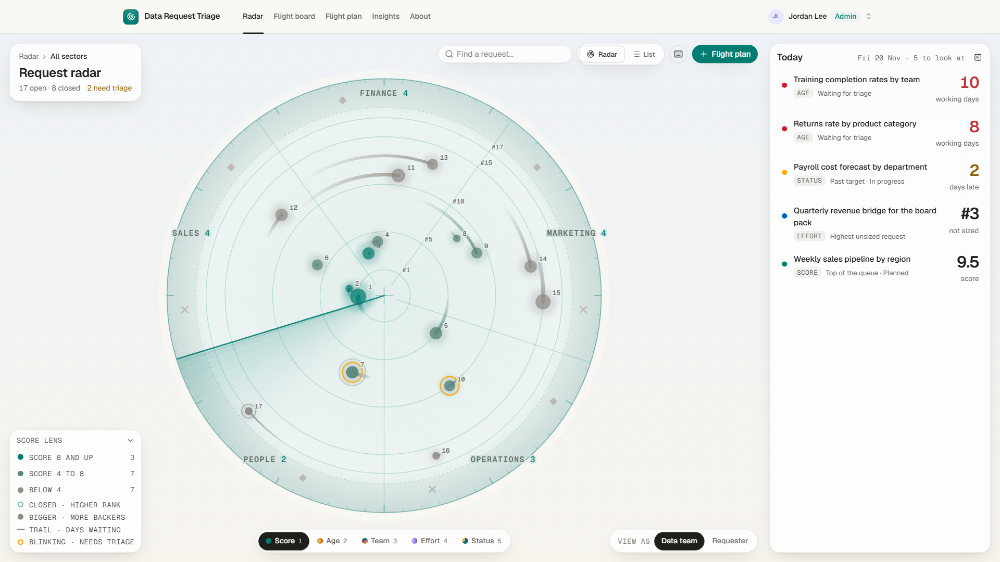

# Data Request Triage

A public, ranked queue for "can you get me this data" requests. Stakeholders submit asks and back each other's, the
data team sizes, plans and moves them on a board, and everyone can see what is coming next and why something was
declined. Each request gets a priority score from its value, urgency, supporters and effort, so the ranking is open to
anyone who wants to check it. Built as a Microsoft Fabric App (Rayfin 2.0, preview).



## What it looks like

The home screen is a **radar**: a sweep turns over the queue and every request is a blip. Distance from the centre is
rank (closer = higher priority score), the sector is the team that asked, blip size is supporters, the trail behind a
blip is how long it has waited, and requests still waiting for triage blink; closed requests ride the outer band.

- **Lenses** (keys 1–5): score, age, team, effort, status. Hover or focus a blip for its score breakdown.
- **Today**: the three to five things that need attention now (stale triage, overdue targets, the highest unsized
  request, the top of the queue); each one flies the radar to its blip. **View as** data team or requester (key V)
  turns Today into "where my requests sit".
- **Tools**: **Radar** (the queue), **Flight board** (a kanban by status with "Move"), **Flight plan** (submit, with a
  mini duplicate radar that pulls similar requests in as you type and a projected score), **Black box** (on every
  request page: time held in each status and the append-only log).
- **Fallbacks**: the radar is SVG, so it needs no WebGL (`?nowebgl` still draws it); **List** (key L) shows the same
  queue as a ranked, filterable list; reduced motion stops the sweep, pings, blinking and camera flights. `?` shows
  every keyboard shortcut. Review screenshots (light/dark, 1280 and 390 px) are in [docs/redesign](docs/redesign).

Demo video (about 2 minutes, AI-generated narration, captions burned in): [demo/out/request-triage.mp4](demo/out/request-triage.mp4) · captions file [demo/out/request-triage.srt](demo/out/request-triage.srt). Re-record with `npx tsx tools/demo/record.ts request-triage` from the repo root.

## Prerequisites

- A Fabric tenant with the **Fabric Apps** workload enabled (preview), and a workspace on a Fabric capacity.
- **Edit** permission (Contributor or higher) on that workspace to deploy.
- Node.js 20 or later.
- Users need access to the app item. Workspace members get it by default; anyone else must be given access to the item.
- No connector or special tenant setting is needed: the app uses only its own Fabric SQL database. Anonymous access is
  not used.

## Run locally

```bash
npm install          # once, at the repo root
cd apps/request-triage
npm run dev          # offline demo on http://localhost:5208 with seed data and a persona switcher
npm run dev:fabric   # rayfin dev: the real Fabric backend and sign-in
```

Demo mode keeps its data in your browser's local storage. Use the identity menu (top right) to switch persona or reset
the demo data. The personas:

| Persona | Role | Use it to show |
|---|---|---|
| Jordan Lee | Data team (admin, default) | Today on the radar, triage panel, flight board "Move", declines, stale-tab refusal |
| Priya Nair | Finance requester | Duplicate suggestions, "Back this instead", editing a triaged request (description only) |
| Marco Silva | Sales requester | Owner of the most-backed request; cannot back his own |
| Hannah Okafor | Operations requester | "Only mine" filter, backing other teams' requests |

Tests: `npx vitest run` (unit and domain), `npx playwright test` (end to end at 390 px and 1280 px).

## Deploy

```bash
cd apps/request-triage
npx rayfin login
npx rayfin up --workspace-id <workspace-id>
npx rayfin up status
```

`rayfin up` builds the app (`npm run build:fabric`), deploys it, and applies schema changes too. Run it again for every
change, including entity changes.

## Seed

```bash
npm run seed:fabric -- --admin-email you@yourorg.com
```

Open the deployed app once first so your Person row exists. The script inserts the seed rows (skipped when the
`seed:v1` marker row exists) and makes you an admin. The seed contains 25 requests from 5 teams in every status
(6 new, 4 triaged, 4 planned, 3 in progress, 5 delivered, 3 declined), 40 supporters, 30 comments and a full status
trail per request, plus 5 fictional colleagues as Person rows. Edge cases: two near-duplicate titles, two requests past
the "needs triage" threshold, a request edited by its requester after triage, a request moved back from in progress to
planned, an overdue target date, and a request declined while it had supporters (with the notice comment). All dates
are relative to the time you run it.

To make someone an admin by hand, in the Fabric SQL editor:

```sql
UPDATE dbo.People SET isAdmin = 1 WHERE email = 'you@yourorg.com';
```

## How it works

### Entities

| Entity (table) | Fields | Notes |
|---|---|---|
| DataRequest (`DataRequests`) | title (5–120), description (1–2000), team (1–80), requesterSub, requesterName, value (1–5), urgency (low/normal/high), effort (S/M/L/XL, optional), status (new/triaged/planned/in_progress/delivered/declined), assigneeName (≤100, optional), targetDate (optional), declineReason (≤300, optional), duplicateOfId (optional), createdAt, updatedAt | The request. |
| Supporter (`Supporters`) | requestId, voterSub, createdAt | One per user per request ("me too"), toggled. |
| RequestComment (`RequestComments`) | requestId, authorSub, authorName, body (1–600), createdAt | Comments, never edited. |
| StatusChange (`StatusChanges`) | requestId, fromStatus (empty on submission), toStatus, bySub, byName, note (≤300), at | Append-only trail. `bySub` was added to the spec's fields so rows are attributable. |
| Person, AppMarker | shared | Identity and seed marker, as generated. |

### Rules (numbers in `src/config.ts`, shown on About)

- **Priority score** = (value × 2 + urgency points + min(supporters, 5)) ÷ effort weight. Urgency points 0 / 2 / 4;
  effort weights S 1, M 2, L 4, XL 8; unsized requests count as M. The queue sorts by score, then the older request.
- **Transitions**: new → triaged | declined; triaged → planned | declined; planned → in_progress | declined;
  in_progress → delivered | planned. Leaving "new" for the delivery path needs an effort size; declining needs a reason.
- **One transition function** (`transitionRequest` in `src/domain/requests.ts`) re-reads the request, refuses the move
  if the stored status differs from the one the viewer saw (stale tab: the UI explains and refetches), validates the
  move against the table, writes the request, then appends the StatusChange row. Declining a request with supporters
  posts a comment naming them.
- **Requesters** set title, description, team, value and urgency. While a request is new they can change all of it;
  once triaged only the description. Delivered and declined requests are frozen.
- **Duplicate help**: while typing a title, up to 3 open requests whose titles share at least 2 words
  (only function words such as "the", "of", "for" are ignored, plurals folded; "Monthly sales report" matches
  "Weekly sales report") are suggested, with "Back this instead".
- **Needs triage**: a request still new after more than 5 working days (Monday to Friday, UTC) gets a chip.
- **Insights**: value vs effort scatter, requests per team, a funnel of requests that reached each stage (from the
  consistent status trail), and median days from submission to delivery by effort. A unit test and an e2e test check the numbers
  against the seed (25 / 17 open / 2 need triage / median 28 days; funnel 25, 18, 13, 9, 5; medians S 5, M 31, L 60).

### Security model

Everyone signed in reads everything (the queue is public by design). Writes:

| Entity | Row policy (Fabric, database) | Enforced in domain code (both modes) |
|---|---|---|
| DataRequest | create: `claims.sub = requesterSub` **and** `status = 'new'`, only requester fields (`include`); update: **any signed-in user, no row check** (see Known limits), `requesterSub`, `requesterName`, `createdAt` excluded; no delete | Requester-only edits (description only after triage); status, effort, assignee, target date, decline reason and duplicate link are data-team only |
| Supporter | create and delete: `claims.sub = voterSub`; no update | One per user per request (counted as distinct voters on read); not your own request; open requests only |
| RequestComment | create: `claims.sub = authorSub`; no update or delete | Length limits |
| StatusChange | create: `claims.sub = bySub`; no update or delete (append-only) | Only written by `submitRequest` and `transitionRequest`; read back through `consistentTrail` |
| Person | as generated (own row; `isAdmin` excluded from client writes) | — |

## VERIFY outcomes and known limits

- Number, enum and optional-enum columns use `@int({ min, max })`, `@set(...)` and the options form
  `@set({ enum, optional: true })` from `@microsoft/rayfin-core` 2.0. See `shared/NOTES.md` for the scaffold's platform
  VERIFY outcomes (claims, roles, polling, charts).
- All row policies, including the DataRequest create policy that combines the owner check with a literal
  (`status eq 'new'`), deployed to Fabric without errors (checked 20 Nov 2026).

Known limits (what the database does not enforce, and what the app does about it):

- **Any signed-in user can rewrite any request through the GraphQL API.** Rayfin has no admin claim, so a row policy
  cannot say "the requester or a data-team member", and an owner-only update policy would lock the data team out of
  triage. The DataRequest update permission therefore has no row check: only `requesterSub`, `requesterName` and
  `createdAt` are excluded. A user calling the API directly (not through this app) can change **any** request's
  `title`, `description`, `team`, `value`, `urgency`, `status`, `effort`, `assigneeName`, `targetDate`,
  `declineReason`, `duplicateOfId` and `updatedAt`. The app itself enforces who may change what in
  `src/domain/requests.ts` (requester fields by the requester, description only once triaged; everything else by the
  data team). Closing this at the database needs dynamic auth claims (`udf.authClaims`) or a server function (Later).
- **Requests can be back-dated on create.** `createdAt` is a required column with no database default, so it has to be
  in the create `include` list and the client sets it. A user calling the API directly can submit a request with an
  old `createdAt`, which would show the "needs triage" chip early and win score ties. The app always writes the
  current time.
- **Supporter rows can be stacked.** There is no composite unique constraint on (requestId, voterSub), so a user can
  insert several Supporter rows for one request through the API. The app counts **distinct voters** everywhere (queue
  score, supporter counts, request page, decline notice; `src/domain/integrity.ts`, tested), so stacked rows add
  nothing.
- **StatusChange rows can be forged** (attributed to the forger, because `bySub` must equal their sub). The request
  page and Insights read the history through `consistentTrail`, which accepts only rows that continue the chain from
  submission with an allowed move and ends at the request's actual status; other rows are ignored (tested), so forged
  rows do not change the funnel or delivery times. They remain in the table.
- **The Fabric build embeds the Rayfin API URL** (it contains the tenant and workspace ids) **and the publishable
  key** in the JavaScript bundle, as every Rayfin app does. Neither is a secret: the API still requires Fabric sign-in
  and applies the row policies above.
- "Working days" ignore public holidays.
- Flight board lanes for delivered and declined show the six most recent cards; the radar's list view shows all.
- No live updates: the board refreshes every 15 seconds while visible, and stale moves are refused regardless.

## Later

- Weekly digest of new, planned and delivered requests.
- Public read-only roadmap view.
- CSV import of an existing backlog.
- Database-level admin enforcement through dynamic auth claims or server functions.
- Moving supporters of a declined duplicate onto the original automatically.
- Drag and drop on the board (the "Move to…" menu covers keyboard and touch).

## Gallery

**Title:** 12 Days of Fabric Apps: Day [#] – [Theme]: Data Request Triage

**Blurb (80 words max):** Every data ask on one radar. Distance from the centre is priority, sectors are teams, blip
size is supporters and trails show waiting time; stale requests blink. Lenses re-colour it by score, age, team, effort
or status, and Today flies you to what needs triage. Requesters file a flight plan and see duplicates close in as they
type; the data team moves cards on a flight board, and every request keeps a black box. Runs on Fabric Apps with a
Fabric SQL database.

**Tags:** Partner | 12 Days of Fabric Apps, Fabric Apps, Data team, Request management, SQL database
